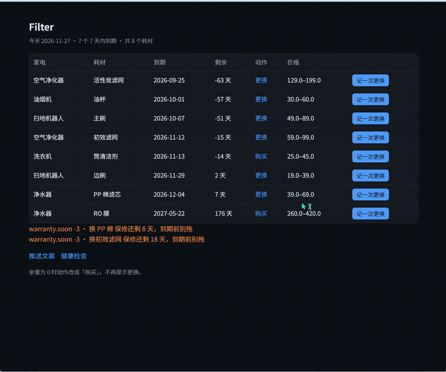

# Filter

[](https://github.com/wushiyi105-jpg/filter/actions)



What to replace, when, and what a fair price looks like.

## What it does

- computes due dates from last replacement, cycle and usage intensity;
- turns stock 0 into "buy", not "replace";
- warns 30 days before a warranty ends;
- drops model prices outside the reference range;
- pushes each consumable at most once a day.

## Run

```bash
pip install -e ".[dev]"
python -m filter seed
python -m filter due --day 2026-11-27
python -m filter serve
```

## Author

shiyi · GitHub [@wushiyi105-jpg](https://github.com/wushiyi105-jpg) · wushiyi105@gmail.com
