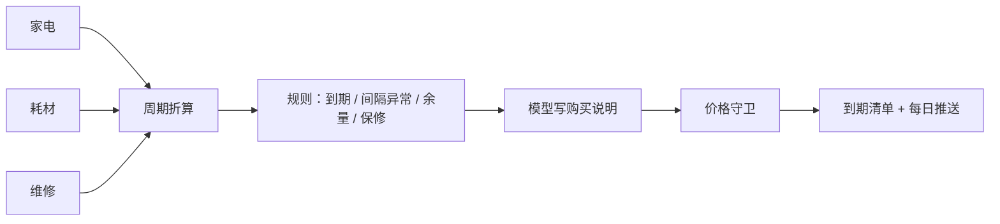

# Filter · appliance upkeep

[](https://github.com/wushiyi105-jpg/filter/actions)

[](./LICENSE)


Know what to replace, when, and what a fair price looks like.

## Features

- Computes the next replacement date from interval, usage intensity and the last change.
- Turns stock of 1 or 0 into a buy-now action instead of a replace action.
- Warns 30 days before a warranty expires.
- Drops model-quoted prices outside the local reference band and falls back to the band.

Rules live in `filter/domain/rules/`; the CLI and the web layer only call them. The Chinese README lists every `rule_id` with its penalty.

## Quickstart

```bash
pip install -e ".[dev]"
python -m filter seed
python -m filter due --day 2026-11-27
python -m filter jobs --day 2026-11-27
python -m filter serve        # http://127.0.0.1:8003
```

Run `python -m filter --help` for the full command list; `docker build -t filter . && docker run -p 8003:8003 filter` works the same way.

## Why not just ask a general LLM

A filter running 24 hours a day lasts half as long as one running 8 hours. Filter keeps intervals as days, scales them by usage, and combines that with stock and warranty instead of repeating a generic “change every 6 months”.

## When to use it

- You own a dozen appliances with different consumable cycles.
- You run more than one home and want a single shopping list.

## Roadmap

- Look up current prices so the list links to a store page.
- Scan the model QR code to fill intervals.

## FAQ

**Does it order parts for me?**
No, it only produces a purchase list.

**Where do the price bands come from?**
Seeded local ranges; out-of-band model quotes are discarded.

## Commands

See the Chinese README (`README.md`) for the command table with flags; every command supports `--help`.

## Dependencies

FastAPI + Uvicorn, Jinja2, pydantic / pydantic-settings, httpx, Typer + Rich, SQLAlchemy + Alembic; dev extras add pytest, pytest-cov, respx, freezegun, ruff, mypy, pip-audit. Version pinning lives in `uv.lock`.

## How it works



## Layout

```
filter/
├── .github/
│   ├── ISSUE_TEMPLATE
│   ├── PULL_REQUEST_TEMPLATE.md
│   └── workflows
├── assets/
│   └── demo.gif
├── data/
│   ├── filter.db
│   └── seed.json
├── filter/
│   └── … 9 项
├── migrations/
│   ├── __init__.py
│   ├── env.py
│   ├── script.py.mako
│   └── versions
├── prompts/
│   └── advice.md
├── templates/
│   └── index.html
├── tests/
│   └── … 7 项
├── CHANGELOG.md
├── CODE_OF_CONDUCT.md
├── CONTRIBUTING.md
├── Dockerfile
├── LICENSE
├── README.en.md
├── README.md
├── SECURITY.md
├── alembic.ini
├── pyproject.toml
```

## Author

shiyi · GitHub [@wushiyi105-jpg](https://github.com/wushiyi105-jpg) · wushiyi105@gmail.com
