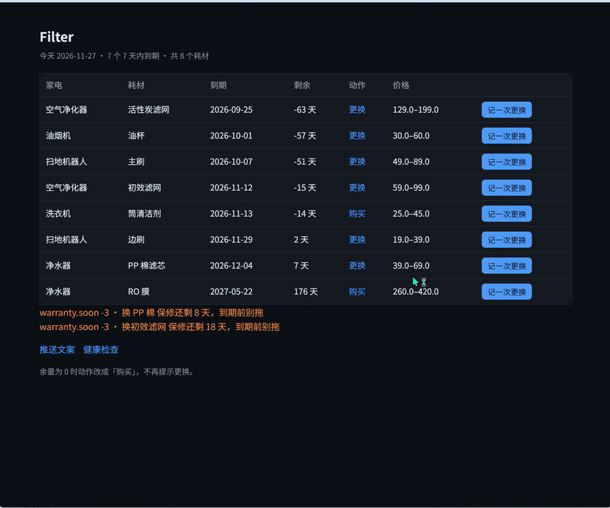

# Filter · 家电保养

[](https://github.com/wushiyi105-jpg/filter/actions)

[](./LICENSE)



该换什么、什么时候换、多少钱合理。

## 为什么不是问一句「滤芯多久换」

每台机器的使用强度不一样：净化器开 24 小时和开 8 小时，滤网寿命差一倍。Filter 把周期存成天数，
按使用强度折算下次到期日，再和余量、保修一起算——余量为 0 时只提醒购买，不提醒更换。

## 它做什么

1. **周期推算**：上次更换 + 周期 / 使用强度；跨月、闰年都按日历算。
2. **耗材余量**：≤1 进待购，0 时动作改成「购买」。
3. **保修窗口**：到期前 30 天提示。
4. **价格守卫**：模型给的报价越出参考区间就丢掉，用本地区间兜底。
5. **每日推送**：同一耗材同一天只推一次。

## 怎么用

```bash
pip install -e ".[dev]"
python -m filter seed
python -m filter due --day 2026-11-27
python -m filter jobs --day 2026-11-27
python -m filter serve        # http://127.0.0.1:8003
```

真实种子：5 台家电、8 个耗材、3 次维修。`due --day 2026-11-27` 列出 8 项：5 项已过期（活性炭 -63 天、油杯 -57、
主刷 -51、初效滤网 -15、筒清洁剂 -14 且余量 0 动作改为「购买」），PP 棉 7 天后到期，RO 膜余量 0 同样只提醒购买；
保修方面有 2 条在 30 天内到期（8 天、18 天）。

## 规则与扣分

| rule_id | 含义 | 扣分 |
| --- | --- | --- |
| `interval.due` | 已到期 | 2 |
| `interval.irregular` | 更换间隔与周期差 > 50% | 5 |
| `stock.low` | 余量 ≤ 1 | 3 |
| `stock.empty` | 余量 0，只提醒购买 | 2 |
| `warranty.soon` | 保修 30 天内到期 | 3 |
| `guard.price` | 报价越界，丢弃 | 6 |

## 边界

- 不接电商下单，只给购买清单；
- 周期表在 `data/seed.json`，按自家型号改；
- 不承诺价格，区间只是参考。

## 作者

shiyi · GitHub [@wushiyi105-jpg](https://github.com/wushiyi105-jpg) · wushiyi105@gmail.com
