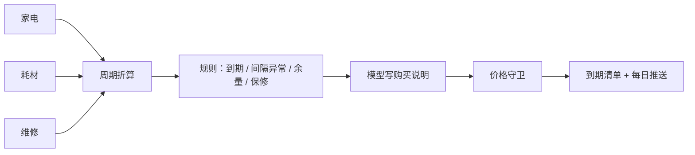

# Filter · 家电保养

[](https://github.com/wushiyi105-jpg/filter/actions)

[](./LICENSE)


该换什么、什么时候换、多少钱合理。


## 功能特性

1. **周期推算**：上次更换 + 周期 / 使用强度；跨月、闰年都按日历算。
2. **耗材余量**：≤1 进待购，0 时动作改成「购买」。
3. **保修窗口**：到期前 30 天提示。
4. **价格守卫**：模型给的报价越出参考区间就丢掉，用本地区间兜底。
5. **每日推送**：同一耗材同一天只推一次。

### 规则与扣分

| rule_id | 含义 | 扣分 |
| --- | --- | --- |
| `interval.due` | 已到期 | 2 |
| `interval.irregular` | 更换间隔与周期差 > 50% | 5 |
| `stock.low` | 余量 ≤ 1 | 3 |
| `stock.empty` | 余量 0，只提醒购买 | 2 |
| `warranty.soon` | 保修 30 天内到期 | 3 |
| `guard.price` | 报价越界，丢弃 | 6 |

## 快速开始

```bash
pip install -e ".[dev]"
python -m filter seed
python -m filter due --day 2026-11-27
python -m filter jobs --day 2026-11-27
python -m filter serve        # http://127.0.0.1:8003
```

真实种子：5 台家电、8 个耗材、3 次维修。`due --day 2026-11-27` 列出 8 项：5 项已过期（活性炭 -63 天、油杯 -57、
主刷 -51、初效滤网 -15、筒清洁剂 -14 且余量 0 动作改为「购买」），PP 棉 7 天后到期，RO 膜余量 0 同样只提醒购买；
保修方面有 2 条在 30 天内到期（8 天、18 天）。

## 为什么不用通用大模型直接问

每台机器的使用强度不一样：净化器开 24 小时和开 8 小时，滤网寿命差一倍。Filter 把周期存成天数，
按使用强度折算下次到期日，再和余量、保修一起算——余量为 0 时只提醒购买，不提醒更换。

## 适用场景

- 家里十来台家电，净化器滤网、净水器 RO 膜、扫地机主刷，各是各的周期。
- 出租屋和自住两套设备，想知道哪些耗材该补货。
- 保修快到期了，想提前知道。

### 边界

- 不接电商下单，只给购买清单；
- 周期表在 `data/seed.json`，按自家型号改；
- 不承诺价格，区间只是参考。

## Roadmap

- 接电商价格查询，购买清单直接给链接（现在只给参考区间）。
- 扫机身二维码录型号，省掉手填周期。
- 多住所分组管理。

## FAQ

**会自动下单吗？**
不会，只出购买清单。

**使用强度怎么算？**
耗材按天数存周期，再按你录的使用强度折算下次到期日。

**价格区间哪来的？**
本地区间写在种子里，模型报价越界就丢掉，用本地区间兜底。

**Docker 镜像验证了吗？**
CI 的 `docker` job 每次执行 `docker build .`，启动容器并轮询 `/health`；本机没有 Docker，本地未重复跑。

## 命令参考

| 命令 | 作用 | 常用参数 |
| --- | --- | --- |
| `seed` | 写入家电、耗材与维修记录。 | --db |
| `due` | 到期清单。 | --day, --db |
| `scan` | 7 天内到期的推送文案。 | --day, --db |
| `jobs` | 每日扫描入队 / 执行。 | --day, --run, --db |
| `doctor` | 四项体检。 | --db |
| `serve` | Web 界面。 | --port, --db |

全部命令都支持 `--help`；只读命令不带参数时读默认库 `data/filter.db`，写命令用 `--db` 指到别的库。

## 依赖说明

| 依赖 | 为什么装 | 不装会怎样 |
| --- | --- | --- |
| `fastapi` + `uvicorn[standard]` | Web 入口与 ASGI 服务 | 只有命令行，没有页面 |
| `jinja2` | 服务端渲染模板 | 页面出不来 |
| `pydantic` + `pydantic-settings` | 配置与数据结构校验，`.env` 直接生效 | 配置散在代码里，改端口要改源码 |
| `httpx` | 调模型与 webhook 的 HTTP 客户端 | 模型层与推送都不可用 |
| `typer` + `rich` | 命令行与终端表格 | 只能用 curl 调接口 |
| `sqlalchemy` + `alembic` | 本地库与迁移 | 表结构变更只能删库重来 |
| `pytest` / `pytest-cov` / `respx` / `freezegun`（dev） | 单测、覆盖率、HTTP 打桩、冻结时间 | 规则改动没有回归保护 |
| `ruff` / `mypy` / `pip-audit`（dev） | 风格、类型、依赖漏洞检查 | CI 只看测试，类型错误会漏进主干 |

装了 `uv` 的话，`uv sync --extra dev` 会按 `uv.lock` 装同一套版本。

## 工作原理




domain 里是周期折算、余量、保修与价格守卫；app 负责到期清单与推送。

## 目录结构

```
filter/
├── .github/
│   ├── ISSUE_TEMPLATE
│   ├── PULL_REQUEST_TEMPLATE.md
│   └── workflows
├── assets/
│   └── demo.gif
├── data/
│   ├── filter.db
│   └── seed.json
├── filter/
│   └── … 9 项
├── migrations/
│   ├── __init__.py
│   ├── env.py
│   ├── script.py.mako
│   └── versions
├── prompts/
│   └── advice.md
├── templates/
│   └── index.html
├── tests/
│   └── … 7 项
├── CHANGELOG.md
├── CODE_OF_CONDUCT.md
├── CONTRIBUTING.md
├── Dockerfile
├── LICENSE
├── README.en.md
├── README.md
├── SECURITY.md
├── alembic.ini
├── pyproject.toml
```

## 质量与供应链

- CI 的 Coverage 步骤带 `--fail-under=70`，覆盖率低于 70% 直接失败。
- `tests/test_app_fake.py` 用真实 `InMemoryStore` 跑主用例，并显式标注 `StorePort` 交给 mypy 做结构校验；测试不创建 SQLite 文件。
- Audit 步骤用 `pip-audit --path` 扫描虚拟环境的 site-packages，跳过本地可编辑包；第三方依赖有漏洞就让 job 失败，不用 `|| true` 吞错。

## 作者

大钊 · GitHub [@wushiyi105-jpg](https://github.com/wushiyi105-jpg) · 17382987315
